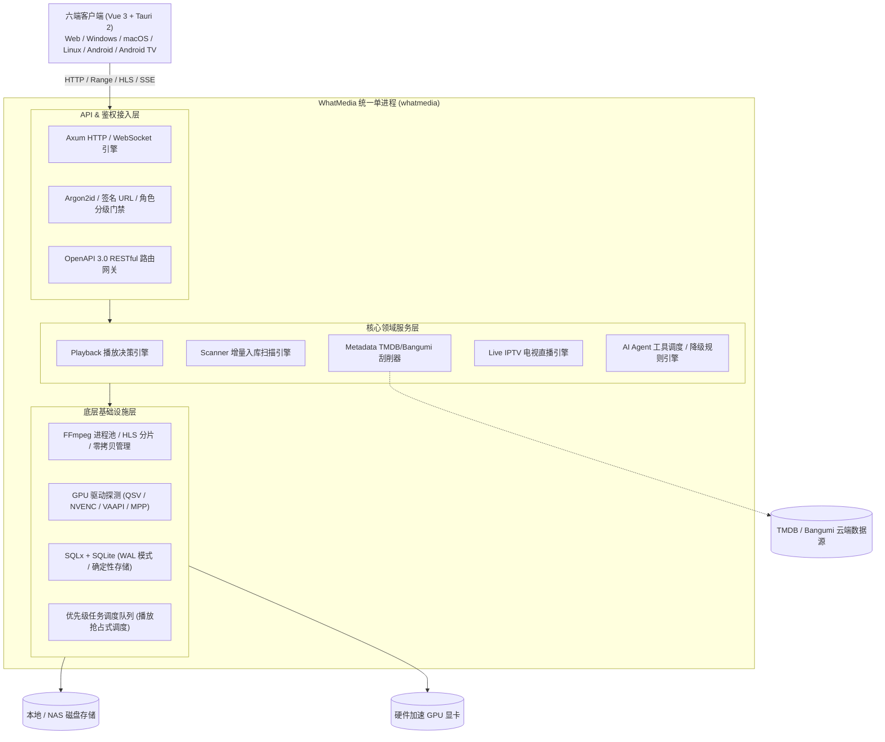

# WhatMedia

<p align="center">
  <strong>把分散的媒体，拼成一个智能的影音空间。</strong><br>
  AI 原生 · 极简部署 · 硬件加速 · 跨平台私有流媒体服务器
</p>

<p align="center">
  
  
  
  
  
</p>

---

## 目录

- [一、 项目愿景与设计理念](#一-项目愿景与设计理念)
- [二、 核心功能全景](#二-核心功能全景)
  - [1. 媒体库管理与智能入库](#1-媒体库管理与智能入库)
  - [2. 混合元数据刮削与字段锁定](#2-混合元数据刮削与字段锁定)
  - [3. 流媒体播放与硬件转码引擎](#3-流媒体播放与硬件转码引擎)
  - [4. 电视直播 (IPTV)](#4-电视直播-iptv)
  - [5. AI 原生智能助手](#5-ai-原生智能助手)
  - [6. 多用户安全与家庭儿童分级](#6-多用户安全与家庭儿童分级)
  - [7. 现代影音墙与六端多形态适配](#7-现代影音墙与六端多形态适配)
- [三、 系统架构与技术设计](#三-系统架构与技术设计)
  - [1. 总体分层架构](#1-总体分层架构)
  - [2. 单二进制设计 (Single Binary)](#2-单二进制设计-single-binary)
  - [3. 模块职责与 Crate 拓扑](#3-模块职责与-crate-拓扑)
  - [4. 架构设计与依赖铁律](#4-架构设计与依赖铁律)
- [四、 核心技术机制深潜](#四-核心技术机制深潜)
  - [1. 播放决策流水线 (Direct Play 优先)](#1-播放决策流水线-direct-play-优先)
  - [2. 硬件加速链与零拷贝容错回退](#2-硬件加速链与零拷贝容错回退)
  - [3. 毫秒级增量指纹扫描与性能实测](#3-毫秒级增量指纹扫描与性能实测)
  - [4. 中文全文检索 (SQLite FTS5 Trigram)](#4-中文全文检索-sqlite-fts5-trigram)
- [五、 统一命令行 (CLI) 完整手册](#五-统一命令行-cli-完整手册)
- [六、 本地开发与构建](#六-本地开发与构建)
- [七、 生产环境部署](#七-生产环境部署)
  - [1. Docker 容器化部署 (推荐)](#1-docker-容器化部署-推荐)
  - [2. Linux 裸机 Systemd 部署](#2-linux-裸机-systemd-部署)
  - [3. 环境变量完整速查表](#3-环境变量完整速查表)
  - [4. 反向代理与公网安全加固](#4-反向代理与公网安全加固)
- [八、 疑难排查与常见问题 (FAQ)](#八-疑难排查与常见问题-faq)

---

## 一、 项目愿景与设计理念

WhatMedia 是为现代家庭、影音发烧友及私有云玩家量身打造的私有流媒体服务中心。它旨在替代笨重繁琐的传统方案，提供高颜值、低资源开销且极致流畅的观影体验。

### 核心设计哲学
1. **原画直出优先（Direct Play First）**：能直出的绝不 Remux，能 Remux 的绝不转码。最大程度榨干局域网带宽与客户端播放能力，解放服务器 CPU/GPU。
2. **单二进制极简运维（Single Binary）**：服务端守护进程与全功能运维调试命令行（CLI）融为一体，分发无任何系统级依赖，开箱即用。
3. **真实诚实，杜绝虚假数据**：绝不为了界面美观编造不可靠数据（如不可靠的磁盘总容量、虚拟播放版本），空状态明确告知原因。
4. **安全与家庭导向（Family-Centric Security）**：全系统严格强制鉴权，从第一天起内置基于角色的家庭分级闸门与新设备家长审批流程。
5. **AI 原生集成（AI-Native）**：内置大模型工具调用与规则引擎双模驱动，支持通过自然语言查片、智能运维与系统自诊断。

---

## 二、 核心功能全景

### 1. 媒体库管理与智能入库
* **多类型媒体支持**：自动辨析电影（Movie）、多季多集电视剧（Series/Season/Episode）及其他独立音视频。
* **确定性 UUIDv5 标识**：基于存储协议与物理绝对路径哈希生成媒体唯一标识，文件改名或路径结构调整不会产生重复条目，不污染观影历史。
* **本地 NFO 最高优先级解析**：完美兼容 Kodi / Jellyfin / Emby 标准 NFO 规范（`movie.nfo`、`tvshow.nfo`、`season.nfo`、`episodedetails`），离线元数据直接入库。
* **毫秒级增量扫描**：比对文件 `mtime`（最后修改时间）与文件体积哈希指纹，无变动文件瞬间跳过，扫描吞吐达数千条/秒。

### 2. 混合元数据刮削与字段锁定
* **可插拔双 Provider 链**：内置 **TMDB**（欧美/华语主流影视）与 **Bangumi**（二次元番剧动漫），自动提取官方中文海报、演职人员头像及高清背景剧照。
* **智能候选打分系统**：采用文本 Levenshtein 编辑距离 × 上映年份权重算法。自动判定置信度：高置信度自动采纳，分差接近时安全移交人工审核队列。
* **字段级永久防覆盖锁定（Field-Level Lock）**：用户手动编辑或修正过的标题、简介、海报等任意字段，自动打上持久化锁标记，后续全量重扫绝对不会覆盖用户的人工编辑成果。
* **内置崩溃自愈机制**：刮削队列支持断点续跑，服务崩溃或意外重启时，自动回收遗留的中断任务并重入队列。

### 3. 流媒体播放与硬件转码引擎
* **全平台客户端能力感知**：针对 Web 浏览器、Tauri 桌面端（内置 MPV）、移动端（Android Media3 / iOS AVPlayer）进行特征匹配。
* **智能硬件转码降级链**：原生集成 Intel QuickSync (QSV)、NVIDIA NVENC、Linux VAAPI、Rockchip MPP 等主流硬件加速后端；当硬件编码器发生显存溢出或格式不支持时，系统**透明静默降级**为高效软件编码，前端播放绝不中断。
* **HDR 动态色调映射（Tone Mapping）**：在 SDR 显示设备上自动调用硬件/软滤镜执行 HDR10/HLG 到 BT.709 色彩空间的科学映射，告别画面灰白失真。
* **智能字幕管线**：支持内嵌与同名外挂字幕（SRT / VTT / ASS / PGS / SUB）。Web 端自动将 ASS 转换为标准 WebVTT；图形字幕（PGS）依据终端能力自动决定直传或动态烧录。

### 4. 电视直播 (IPTV)
* **M3U / M3U8 列表极速解析**：支持标准 IPTV 播放列表一键导入，自动提取频道台标（Logo）、频道分组及 EPG 映射键。
* **流状态实时探测**：内置流媒体连通性健康探测器，智能标记失效频点并提供频道故障自动重连缓冲。
* **多协议支持**：支持单播 HTTP/HTTPS 流、HLS 分片流以及局域网组播源。

### 5. AI 原生智能助手
* **自然语言找片选片**：支持多维度语义检索（例如：“*找出 90 年代评分大于 8.5 的科幻悬疑电影*”、“*有哪些适合全家一起看的动画剧集*”）。
* **会话式运维助手**：支持通过自然语言执行管理命令（“*帮我扫描 D 盘媒体库*”、“*找出当前库中没有海报的条目并重新刮削*”）。
* **安全沙箱保护**：具备风险分级控制，针对修改设置、触发高并发重扫等破坏性操作，强制进入人工二次确认（Wait for User Confirmation）。
* **双模平滑降级**：未配置任何大模型 API Key 时，AI 系统自动无缝降级为内置的**规则推理引擎**，核心语义分析与基础指令依然可用。
* **开放 MCP 协议**：对外支持 Model Context Protocol，可作为只读工具直接接入外部 AI Agent 生态。

### 6. 多用户安全与家庭儿童分级
* **现代强加密体系**：采用 Argon2id 密码哈希，具备防暴力破解的主动账户冻结机制（按账户锁定，避免家庭共享公网 IP 误伤）。
* **全系统强制鉴权**：除健康检查与安装向导外，所有 API 接口一律强制校验会话，拒绝隐蔽未授权访问。
* **设备级会话吊销**：支持多设备独立会话查看与一键远程下线。
* **儿童安全分级与家长审批门禁**：
  * 支持 `admin`、`user`、`child` 三级角色；
  * 儿童账号具备内容分级强闸门；
  * 新设备使用儿童账号登录时，强制进入 `APPROVAL_REQUIRED` 状态，必须由家长在管理端放行后方可进入。
* **双通道播放鉴权**：页面交互使用 HttpOnly Cookie 维持，原生播放组件（`<video>`、ExoPlayer、MPV）采用受时效保护的 HMAC 签名 URL。

### 7. 现代影音墙与六端多形态适配
* **现代暗黑影音视觉**：深度定制的高级紫蓝质感设计（Dark Modern Theme），融合半透明玻璃拟态与大柔阴影。
* **数据驱动的动态界面**：首页顶置高分 Hero 轮播大图，分类标签（Tags）仅在库中确实存在该内容时才动态呈现，拒绝生硬留白。
* **六端一致性体验**：
  * **Web 端**：响应式宽屏与移动端自适应；
  * **桌面端（Windows / macOS / Linux）**：基于 Tauri 2 + MPV 外部进程驱动，MKV / 4K 原画直出无瓶颈；
  * **手持移动端（Android / iOS）**：手势操作与沉浸式全屏；
  * **电视端（Android TV）**：遥控器 D-Pad 焦点驱动，严格遵循 Overscan 安全边距。

---

## 三、 系统架构与技术设计

### 1. 总体分层架构



### 2. 单二进制设计 (Single Binary)
自当前版本起，WhatMedia 采用**单二进制合并架构**：
* 整个后端服务及所有运维工具仅编译为一个最终可执行文件 `whatmedia`（或 `whatmedia.exe`）。
* **默认 / 服务模式**：无参直接执行或运行 `whatmedia serve`，拉起 HTTP Web 服务端；
* **运维 / CLI 模式**：通过 `whatmedia <subcommand>`（如 `whatmedia scan`）执行一次性运维任务；
* **构建体积优化**：共享底层静态链接库，二进制总积与镜像体积相比分散编译减少约 **35%**；
* **历史兼容垫片**：系统内置 `whatmedia-server` 与 `whatmedia-cli` 二进制垫片，旧版部署脚本与 Makefile 100% 保持向前兼容。

### 3. 模块职责与 Crate 拓扑

WhatMedia 采用标准的 Rust Workspace 单体多包（Monorepo）模式，由 1 个主应用与 20+ 个核心 Crate 构成：

| 分类 | Crate / 模块 | 核心职责说明 |
| :--- | :--- | :--- |
| **主入口** | `apps/whatmedia` | 统一可执行主程序，封装服务启动生命周期与全套 CLI 分发 |
| **基础协议** | `crates/core` | 基础领域模型契约（MediaItem, Stream, File, Library, Id 等），**零外部依赖** |
| | `crates/config` | 统一配置系统，支持 TOML 读取、环境变量覆盖与目录自动探测 |
| | `crates/diagnostics` | 服务就绪状态、启动计时器、统一错误信封定义 |
| **存储数据** | `crates/storage` | 本地与远程存储驱动抽象，安全防穿越路径解析 |
| | `crates/database` | SQLx + SQLite 数据库连接池，唯一编写原生 SQL 的数据持久层 |
| **媒体解析** | `crates/media` | 强类型文件名解析器（剧集、季、版本规则识别），FFprobe 探测封装 |
| | `crates/library` | 媒体库编排与入库管线，UUIDv5 确定性标识派生 |
| | `crates/scanner` | 增量扫描引擎，文件指纹比对，可取消并发遍历 |
| **转码播放** | `crates/hardware` | 跨平台 GPU 硬件加速节点自检（DRM, NVIDIA, QSV, MPP） |
| | `crates/transcoder` | FFmpeg 进程调度池，参数动态构建，HLS 分片切片，HDR 色调映射 |
| | `crates/playback` | 播放决策裁决中心（Direct Play / Remux / 转码），会话心跳与进度追踪 |
| | `crates/subtitle` | 字幕轨扫描（内嵌+外挂），格式自动转换（ASS/SRT → WebVTT）与压制规划 |
| **增值业务** | `crates/metadata` | TMDB / Bangumi / 本地 NFO 混合刮削，候选打分，图片多规格缓存池 |
| | `crates/live` | M3U 播放列表解析，IPTV 频道管理，直播流连通性探针 |
| | `crates/auth` | Argon2id 密码哈希，设备签名票据，多角色权限控制，儿童设备家长审批 |
| | `crates/ai` | 大模型函数调用（Function Calling）与规则兜底推理引擎 |
| | `crates/api` | Axum HTTP 路由绑定，WebSocket 协同，OpenAPI 3.0 契约生成 |

### 4. 架构设计与依赖铁律
* **严格单向依赖**：`core` 严禁依赖任何其它内部 crate；`storage` / `hardware` / `metadata` 仅依赖 `core` 与 `config`；`api` 作为最外层聚合各领域模块。严禁任何形式的跨层反向依赖或循环依赖。
* **单一 SQL 写入口**：只有 `whatmedia-database` 拥有写 SQL 的权利，其余业务领域严禁直接引入 `sqlx` 写原生查询，保证数据库表结构变动收敛可控。
* **非致命降级原则**：未安装 FFmpeg、未配置 TMDB API Key、或 AI 离线均**不影响服务启动**。系统通过清晰的状态码（如 501 / 503）与降级逻辑保障可用性。

---

## 四、 核心技术机制深潜

### 1. 播放决策流水线 (Direct Play 优先)
当客户端发起播放请求时，WhatMedia 并不盲目启动转码，而是经过严格的判定流水线：

```
[客户端请求播放] ───> 提取客户端能力 (容器/视频编码/音频/字幕格式)
                               │
                               ▼
               ┌───────────────────────────────┐
               │ 容器、视频轨、音频轨均被终端支持? │
               └───────┬───────────────┬───────┘
                     YES               NO
                      │                 │
                      ▼                 ▼
             [Direct Play 原画直出]     ┌────────────────────────┐
             (零 CPU/GPU 负载传输)     │ 仅音频或容器格式不匹配?  │
                                       └────┬──────────────┬────┘
                                          YES              NO
                                           │                │
                                           ▼                ▼
                                      [Direct Stream]   [完全转码流水线]
                                      (仅做流封装Remux)  (GPU硬件加速转码)
```

### 2. 硬件加速链与零拷贝容错回退
系统在识别到需要转码时，按如下优先级链式推进：
1. **优先硬件编码器**：根据探测结果按 `QSV → NVENC → VAAPI → Rockchip MPP` 优选；
2. **零拷贝（Zero-Copy）管道**：GPU 硬件解码输出表面直接喂入 GPU 硬件编码器，避免数据帧在系统内存（RAM）与显存（VRAM）之间来回拷贝；
3. **静默自愈回退**：若硬件编码器启动失败（驱动崩溃、显存不足），进程池在 500ms 内瞬间切换到 CPU 软件编码器（libx264/libx265），前端播放不会断流报错。

### 3. 毫秒级增量指纹扫描与性能实测
测试环境：Windows x86_64 / Intel 8 逻辑核 / Debug 构建 / `probe=false` / 并发 8：

| 媒体文件规模 | 冷扫描（首次入库） | 热扫描（增量指纹核验） |
|---|---|---|
| **10,000 文件** | ~104 秒 | **~1.0 秒** |
| **1,000 文件** | 10.2 秒 | **0.07 秒** |

*注：热扫描耗时仅用于确认文件 mtime/size，几乎不产生磁盘 I/O 阻塞。*

### 4. 中文全文检索 (SQLite FTS5 Trigram)
为避免引入 Elasticsearch 或 Java 等高开销组件，系统采用 SQLite 原生 FTS5 引擎配合 `trigram` 分词器：
* 支持拼音及任意中文子串即时检索；
* 针对 1~2 个汉字的超短查询自动平滑降级到短词匹配；
* 5 万条以内条目毫秒级响应，零外部守护进程。

---

## 五、 统一命令行 (CLI) 完整手册

WhatMedia 编译生成的单一二进制支持全方位的命令行管理与排障功能：

```bash
whatmedia [子命令] [参数...]
```

### 常用子命令速查表

| 子命令 | 参数示例 | 说明 |
| :--- | :--- | :--- |
| **`serve`** | `whatmedia serve --config ./whatmedia.toml` | 启动 Web 服务端（直接运行 `whatmedia` 缺省执行此命令） |
| **`scan`** | `whatmedia scan --path "D:/Media" --probe` | 扫描指定文件夹。`--probe` 开启音视频规格流探测，`--full` 强制全量重扫 |
| **`list`** | `whatmedia list --limit 50 --kind movie` | 列出数据库中已登记的媒体条目 |
| **`search`** | `whatmedia search --q "黑客帝国"` | 全文模糊检索电影与剧集 |
| **`libraries`** | `whatmedia libraries` | 查看当前已登记的所有媒体库及其物理根路径 |
| **`scrape`** | `whatmedia scrape --library <ID> --retry-failed` | 批量启动元数据刮削。`--review-only` 开启全人工确认模式 |
| **`scrape-stats`** | `whatmedia scrape-stats` | 查看当前刮削队列的就绪、运行、失败统计 |
| **`review`** | `whatmedia review` | 列出当前待人工审核元数据匹配项的列表 |
| **`candidates`** | `whatmedia candidates --item <ID>` | 为指定条目在线搜索 TMDB/Bangumi 的可能匹配候选项 |
| **`identify`** | `whatmedia identify --item <ID> --provider tmdb --provider-id 603` | 人工指定第三方 ID 强制绑定条目元数据 |
| **`lock`** | `whatmedia lock --item <ID> --fields title,overview` | 永久锁定指定字段，避免被后续自动刮削覆盖 |
| **`hardware`** | `whatmedia hardware` | 硬件加速探测自检：检查 CPU 拓扑、GPU 驱动节点与可用转码档位 |
| **`play`** | `whatmedia play --item <ID> --client web` | 离线预演播放决策：模拟指定终端在该片源下的转码参数与 FFmpeg 命令行 |
| **`subtitles`** | `whatmedia subtitles --item <ID>` | 提取并打印指定媒体的内嵌字幕轨与外挂同名字幕 |
| **`resume`** | `whatmedia resume --limit 20` | 查看当前账户未播完的视频记录与进度百分比 |
| **`images`** | `whatmedia images --stats --evict` | 查看海报图片缓存占用，并主动清理超期或超出容量预算的缓存 |
| **`reap-streams`**| `whatmedia reap-streams` | 强制回收清理因异常退出或崩溃遗留的临时 HLS 分片目录 |
| **`config`** | `whatmedia config` | 打印解析合并后的完整运行时配置（排查环境变量覆盖） |
| **`migrations`**| `whatmedia migrations` | 查看当前数据库迁移版本序列与就绪脚本 |
| **`openapi`** | `whatmedia openapi --out docs/openapi/openapi.json` | 导出最新 OpenAPI 3.0 规范契约（供前端代码生成） |

---

## 六、 本地开发与构建

### 1. 前置依赖
* **Rust**：≥ 1.98（MSRV，支持 Edition 2021）
* **Node.js**：≥ 22.x 与 npm
* **FFmpeg / FFprobe**：≥ 7.0（可选，建议安装并加入系统 `PATH`）

### 2. 本地快速启动

#### 终端 1：启动后端服务
```bash
# 启动 HTTP 后端（默认监听 8080 端口）
make dev
# 等价于：RUST_LOG=info WHATMEDIA_LOG_FORMAT=pretty cargo run -p whatmedia -- serve
```
验证服务端就绪：
```bash
curl -s http://127.0.0.1:8080/healthz
# 期望返回: {"status":"ok","version":"0.1.0",...}
```

#### 终端 2：启动前端工程
```bash
cd client
npm install
npm run dev
# 本地前端开发服务器启动于 http://127.0.0.1:1420
```
> 注：前端端口固定为 **1420**，Vite 会自动将 `/api` 请求代理至 `127.0.0.1:8080`。

### 3. 快速录入演示数据（无媒体文件时）
```bash
make seed-demo
```
该命令会自动生成 12 部电影 + 1 部精选剧集元数据、演职员表以及模拟播放记录，便于快速检验影音墙排版。

### 4. 契约同步与代码检查
```bash
# 1. 运行全量后端自动化测试
make test

# 2. 运行前端自动化测试 (Vitest 260+ 测试用例)
cd client && npm test

# 3. 后端 API 契约变更后重新导出并刷新前端 TypeScript 类型
make openapi

# 4. CI 门禁检查（保证契约生成物与后端代码 100% 同步）
make openapi-check
```

---

## 七、 生产环境部署

### 1. Docker 容器化部署 (推荐)

WhatMedia 提供基于 Debian Slim 的官方多架构容器镜像（同时支持 `linux/amd64` 与 `linux/arm64`）。

创建 `docker-compose.yml`：

```yaml
services:
  whatmedia:
    image: ghcr.io/whatmedia/whatmedia:latest
    container_name: whatmedia
    restart: unless-stopped
    ports:
      - "8080:8080"
    environment:
      - TZ=Asia/Shanghai
      - WHATMEDIA_LOG_LEVEL=info
      - WHATMEDIA_LOG_FORMAT=json
      - WHATMEDIA_DATABASE_URL=sqlite:/config/whatmedia.db?mode=rwc
      - WHATMEDIA_METADATA_TMDB_API_KEY=your_tmdb_api_key_here
    volumes:
      - ./config:/config
      - ./data:/data
      - ./cache:/cache
      - ./logs:/logs
      # 媒体目录建议只读挂载 (:ro)，避免误操作风险
      - /mnt/media:/media:ro
    # 如需硬件转码，映射对应系统的显卡渲染节点（按需解注）：
    # devices:
    #   - /dev/dri:/dev/dri      # Intel / AMD 核显与独显
    healthcheck:
      test: ["CMD", "wget", "-q", "-O", "/dev/null", "http://127.0.0.1:8080/healthz"]
      interval: 30s
      timeout: 5s
      start_period: 20s
      retries: 3
```

启动容器：
```bash
docker compose up -d
```

### 2. Linux 裸机 Systemd 部署

#### 编译 Release 二进制
```bash
cargo build --release -p whatmedia
sudo cp target/release/whatmedia /usr/local/bin/
sudo cp -r migrations /usr/local/share/whatmedia/migrations
```

#### 创建 Systemd 服务文件
新建 `/etc/systemd/system/whatmedia.service`：

```ini
[Unit]
Description=WhatMedia Streaming Service
After=network.target

[Service]
Type=simple
User=whatmedia
Group=whatmedia
Environment=WHATMEDIA_DATABASE_URL=sqlite:/var/lib/whatmedia/whatmedia.db?mode=rwc
Environment=WHATMEDIA_CONFIG_DIR=/etc/whatmedia
Environment=WHATMEDIA_DATA_DIR=/var/lib/whatmedia/data
Environment=WHATMEDIA_CACHE_DIR=/var/lib/whatmedia/cache
Environment=WHATMEDIA_LOG_DIR=/var/log/whatmedia
Environment=WHATMEDIA_LOG_FORMAT=json
Environment=WHATMEDIA_MIGRATIONS_DIR=/usr/local/share/whatmedia/migrations
ExecStart=/usr/local/bin/whatmedia
Restart=on-failure
RestartSec=5s

[Install]
WantedBy=multi-user.target
```

激活并启动服务：
```bash
sudo systemctl daemon-reload
sudo systemctl enable --now whatmedia
```

### 3. 环境变量完整速查表

| 环境变量 | 默认值 | 作用域与功能说明 |
| :--- | :--- | :--- |
| `WHATMEDIA_HOST` | `0.0.0.0` | HTTP 服务监听绑定的网络地址 |
| `WHATMEDIA_PORT` | `8080` | HTTP 服务监听端口 |
| `WHATMEDIA_DATABASE_URL` | `sqlite:/config/whatmedia.db?mode=rwc` | SQLite 数据库连接字符串（必须启用 WAL 模式） |
| `WHATMEDIA_CONFIG_DIR` | `/config` | 配置文件存放目录 |
| `WHATMEDIA_CACHE_DIR` | `/cache` | 图片、HLS 流式分片与转码临时文件缓存根路径 |
| `WHATMEDIA_LOG_LEVEL` | `info` | 日志详细级别（`trace` / `debug` / `info` / `warn` / `error`） |
| `WHATMEDIA_LOG_FORMAT` | `pretty` | 日志格式：终端开发建议 `pretty`，生产容器建议 `json` |
| `WHATMEDIA_FFMPEG_PATH` | 系统 `PATH` 中查找 | 手动指定 FFmpeg 可执行文件绝对路径 |
| `WHATMEDIA_METADATA_TMDB_API_KEY` | *(空)* | TMDB v3 API 访问密钥（刮削功能必需） |
| `WHATMEDIA_METADATA_BANGUMI` | `false` | 是否开启 Bangumi 番剧动漫元数据源（设为 `1` 或 `true`） |
| `WHATMEDIA_METADATA_LANGUAGE` | `zh-CN` | 元数据默认刮削语言偏好 |
| `WHATMEDIA_SIGNING_KEY` | *(启动时随机)* | 用于签名播放流 URL 的 HMAC 密钥。多实例集群部署时必须统一设定 |
| `WHATMEDIA_BOOTSTRAP_USER` | *(空)* | 无人值守部署时预置创建的首个管理员用户名 |
| `WHATMEDIA_BOOTSTRAP_PASSWORD`| *(空)* | 预置首个管理员用户的登录密码 |
| `WHATMEDIA_AI_ENABLED` | `false` | AI 助手总开关（设为 `true` 启用） |
| `WHATMEDIA_AI_PROVIDER` | `openai` | 大模型提供商（`openai`/`deepseek`/`qwen`/`ollama`/`vllm` 等） |
| `WHATMEDIA_AI_API_KEY` | *(空)* | 大模型接口访问凭证（支持直接传 key 或指定环境变量） |

### 4. 反向代理与公网安全加固
若通过 Nginx、Caddy 或 Traefik 暴露至公网，请务必注意：
1. **强制开启 HTTPS**：严禁明文 HTTP 传输身份认证票据；
2. **保留 HTTP Range 请求头**：客户端的原画直出（Direct Play）深度依赖 HTTP 206 Partial Content 分段读取，切勿剥离 `Range` 头；
3. **延长反向代理超时时间**：HLS 切片及转码包含长连接流式响应，建议将 `proxy_read_timeout` 至少配置为 `300s`。

---

## 八、 疑难排查与常见问题 (FAQ)

#### Q1: 服务端成功运行，但打开 `8080` 端口只有一行 JSON 说明？
> **解答**：后端专注于提供高性能 RESTful API 与流媒体输出，**不直接兼职静态 Web 服务器**。Web 前端在生产环境中由预构建的客户端静态托管（或打包于桌面端/移动端独立运行）。请访问前端端口（开发模式为 `1420`），或配置 Nginx 将前端静态页面反向代理到后端 `/api`。

#### Q2: 扫描入库后，媒体条目没有海报、封面与剧情简介？
> **解答**：元数据刮削需要配置外部 Provider 密钥。请设置环境变量 `WHATMEDIA_METADATA_TMDB_API_KEY=你的TMDB密钥` 或开启 Bangumi 支持，随后在 Web 设置页或通过命令 `whatmedia scrape` 即可开始抓取。

#### Q3: 为什么 Windows 上直接跑 `whatmedia`，在盘符根目录多出了一个 `D:\config` 文件夹？
> **解答**：未显式指定 `WHATMEDIA_DATABASE_URL` 时，系统默认采用容器化标准路径 `/config`。在 Windows 环境下，绝对路径 `/config` 会解析至当前运行盘符的根部。在 Windows 上本地开发或裸机运行时，建议显式配置环境变量：
> ```powershell
> $env:WHATMEDIA_DATABASE_URL = "sqlite:./whatmedia.db?mode=rwc"
> ```

#### Q4: 提示转码不可用，返回 `501 FFMPEG_UNAVAILABLE`？
> **解答**：服务端未在宿主机系统路径下探测到 `ffmpeg`。可运行 `whatmedia hardware` 查看诊断报告，并通过环境变量 `WHATMEDIA_FFMPEG_PATH="C:/ffmpeg/bin/ffmpeg.exe"` 显式指定安装路径。

---

<p align="center">
  WhatMedia 坚持以工程诚实性与极致性能为准绳。<br>
  欢迎提交 Issue 与 Pull Request 共同构建卓越的私有影音体验。
</p>
